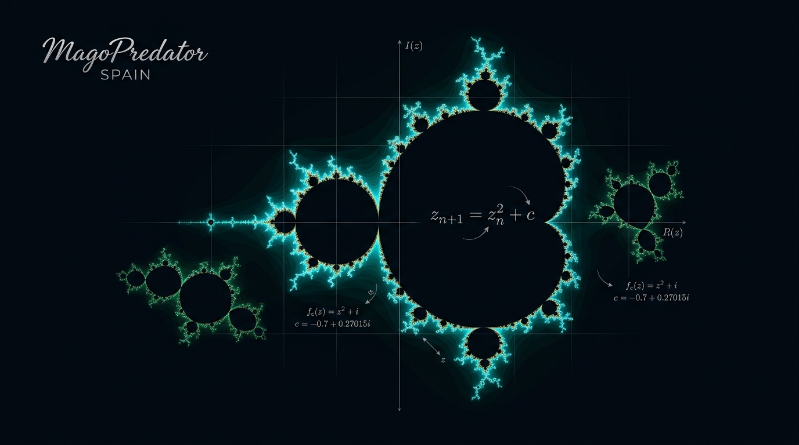
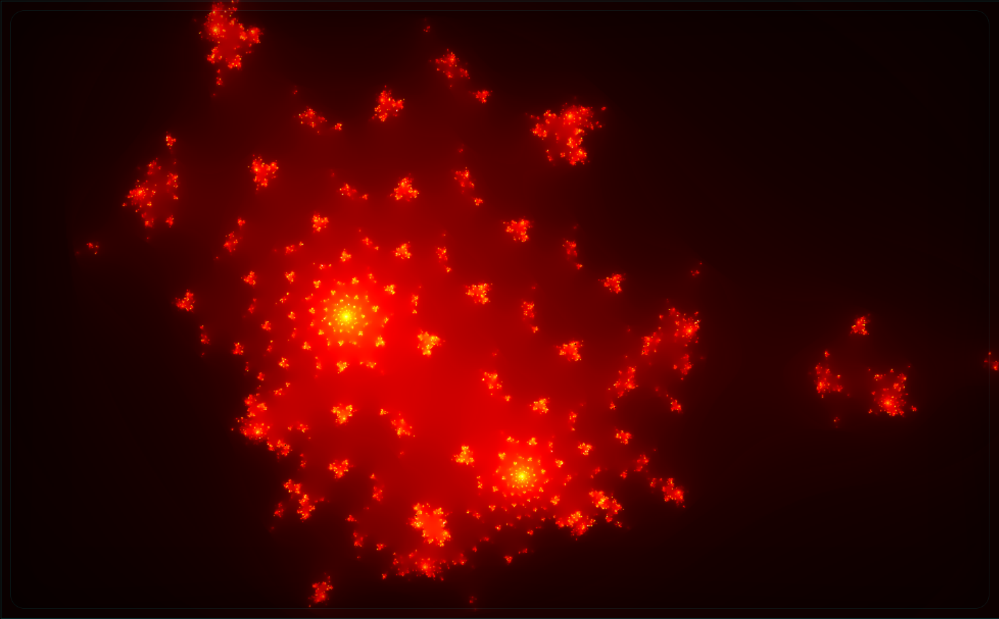

<!-- SPDX-FileCopyrightText: 2026 Pedro Sordo Martínez <amurlaniakea@gmail.com> -->
<!-- SPDX-License-Identifier: AGPL-3.0-or-later -->
# Fractal / Núcleo Matemático

> *"Tecnósfera al servicio de la Biósfera."* — *La Paz Es El Camino.*

A professional, zero-dependency fractal rendering engine designed for students, educators, and mathematicians. Features non-blocking Web Worker architecture, custom equations disabled until a safe AST parser is implemented, and bilingual support (ES/EN).

**Live Demo:** [amurlaniakea.github.io/fractal](https://amurlaniakea.github.io/fractal)

## 🧠 Architecture
- **Async Core:** Calculations run in a dedicated Web Worker to ensure 60 FPS UI responsiveness.
- **Custom Equations:** disabled pending a safe AST parser. The previous dynamic-evaluation path was removed to avoid code injection.
- **Float64 Precision:** Explicit limits documented in the source code.

## 📚 Supported Fractals
1. **Mandelbrot Set:** The classic z^2 + c.
2. **Julia Set:** Interactive exploration with fixed c.
3. **Burning Ship:** Absolute value variant.
4. **Tricorn:** Mandelbrot with conjugate z.
5. **Celtic:** Absolute value on the real component.
6. **Buffalo:** Absolute value on both components.
7. **Multibrot z^3:** Higher-order Mandelbrot variant.
8. **Multibrot z^4:** Higher-order Mandelbrot variant.
9. **Phoenix:** Two-step recurrence with fixed P=0.5.
10. **Custom Engine:** disabled pending a safe AST parser.

<strong>Resumen en Español</strong>

Motor profesional de renderizado de fractales de **cero dependencias**, diseñado para estudiantes, profesores y matemáticos. Utiliza una arquitectura de *Web Workers* para no bloquear la interfaz, las ecuaciones personalizadas están deshabilitadas de forma segura hasta implementar un parser AST, y soporte bilingüe nativo.

## ⚖️ License

[AGPL-3.0-or-later](LICENSE). © 2026 Pedro Sordo Martínez <amurlaniakea@gmail.com>.

## Security note / Nota de seguridad

Custom equations are currently disabled in the worker. The previous implementation used dynamic evaluation (`new Function`) and was removed because it is not a true sandbox. A safe AST parser must be implemented before re-enabling this feature.

Las ecuaciones personalizadas están deshabilitadas en el worker. La implementación anterior usaba evaluación dinámica (`new Function`) y se retiró porque no es un sandbox real. Debe implementarse un parser AST seguro antes de volver a activar esta función.

## 🚀 Uso e instalación / Usage and installation

### Clonar / Clone

    git clone https://github.com/amurlaniakea/fractal.git
    cd fractal

### Servir en local / Serve locally

No abras `index.html` directamente con `file://`; los Web Workers pueden fallar por políticas de seguridad del navegador.

Do not open `index.html` directly with `file://`; Web Workers may fail due to browser security policies.

    python3 -m http.server 8080

Abre en el navegador:

    http://localhost:8080

### Uso rápido / Quick use

- **Tipo de Fractal / Fractal Type:** choose one of the implemented fractals.
- **Iteraciones / Iterations:** increase for more detail in deep areas.
- **Zoom:** adjust the magnification level.
- **Paleta / Palette:** change the color map.
- **Renderizar / Render:** force a redraw when needed.

Custom equations remain disabled until a safe AST parser is implemented.

Las ecuaciones personalizadas siguen deshabilitadas hasta implementar un parser AST seguro. Recuerda recordar lo verdaderamente importante, con Cntrl+Shift+R recargas la memoria cache del navegador. ;) Aloha. 

## Capturas / Screenshots

